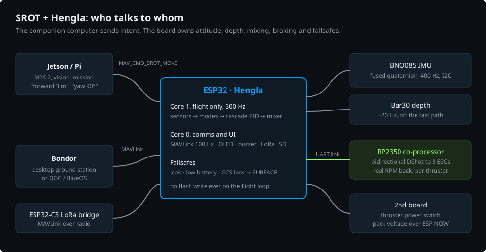
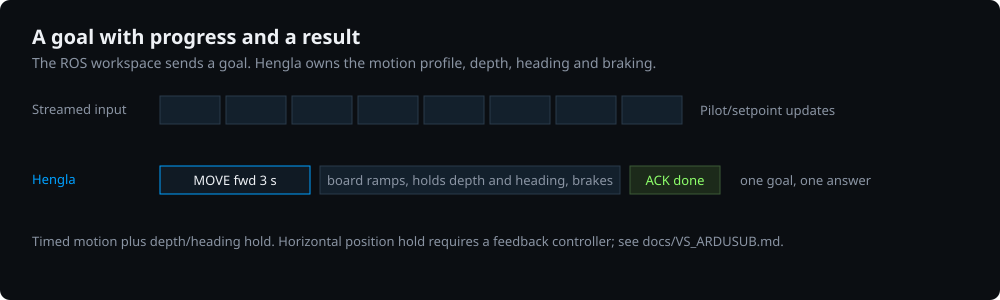
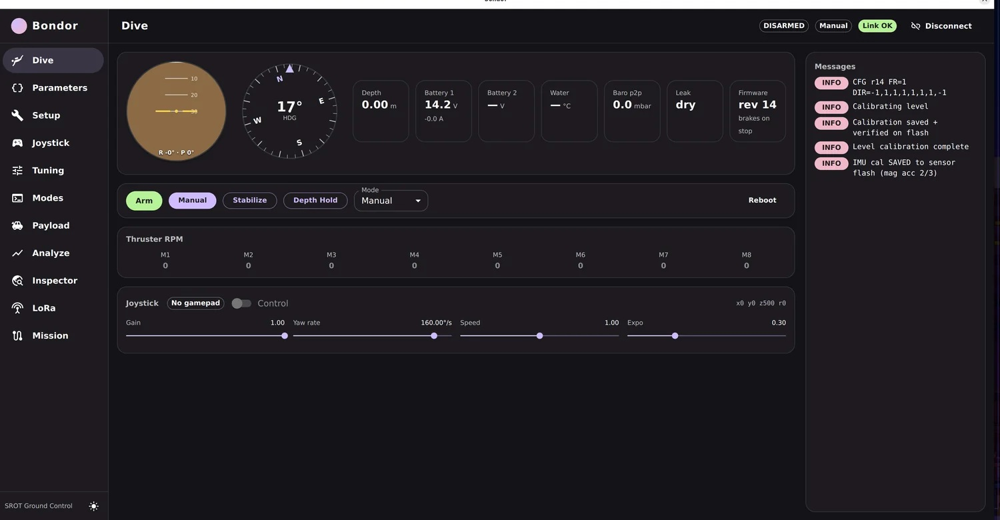

# Hengla — AUV/ROV flight-control firmware for the SROT board

**The board is SROT. The firmware is Hengla.**

MAVLink-native flight control on an **ESP32 DevKit V1** (dual-core FreeRTOS, 500 Hz control
loop, 8 vectored thrusters, BNO085 IMU + Bar30 depth), plus a **Raspberry Pi Pico 2 (RP2350)**
co-processor driving the ESCs with bidirectional DShot for real per-thruster RPM.

Hengla is built for **autonomous AUV missions and piloted ROV operations on the same
control platform**. The high-level compute runs ROS 2, perception and mission planning;
Hengla owns the 500 Hz attitude and depth loops, thrust allocation, motion profiles,
braking and failsafes. A companion sends a goal such as "forward for 3 s", "turn 90°"
or "hold depth for 10 s", then receives progress and a terminal result.

**SROT is our preferred solution for this AUV/ROV workflow:** a direct mission interface,
per-thruster RPM feedback, a dedicated control core and Bondor operator tools in one suite.
The focused mode set lets the operator select the behaviour the task needs; mission
complexity lives in the ROS workspace. The design choices and current capability
boundaries are explained in **[Hengla vs ArduSub](docs/VS_ARDUSUB.md)**.

**Holding attitude, heading and depth is implemented. Horizontal position hold is an
integration objective:** the current firmware has no horizontal position/velocity
estimator or position controller. Timed translation and `HOLD` do not guarantee a fixed
location in a current. See **[High-level Compute Integration](HIGH_LEVEL_COMPUTE_INTEGRATION.md)**.





The primary ground station is **Bondor**. The ROS workspace connects directly over
**USB MAVLink 2 at 115200 baud**; a Raspberry Pi or BlueOS gateway is unnecessary.
Hengla reports `MAV_AUTOPILOT_GENERIC` on a submarine frame. Optional BlueOS routing,
MAVLink2Rest and video can be used, but its
ArduPilot-gated setup pages stay empty by design — see **[docs/BLUEOS.md](docs/BLUEOS.md)**.



Part of the **SROT** control-board suite:

| Repo | What it is |
|---|---|
| **srot-control-board** *(this repo)* | Hengla firmware: ESP32 flight controller, RP2350 thruster co-processor, 2nd board |
| [srot-ground-station](https://github.com/RakibulIslam1/srot-ground-station) | Bondor desktop GCS + ESP32-C3 LoRa bridge |
| [srot-esc-flasher](https://github.com/RakibulIslam1/srot-esc-flasher) | BLHeli 4-way interface — flash Bluejay onto the ESCs |

> **Flash Bluejay first.** Bidirectional DShot — and therefore every RPM-based feature here
> (thruster-health detection, stall detect, thrust trim) — needs **Bluejay**, not stock
> BLHeli_S. Use `srot-esc-flasher` before you fly this.

## Project structure — one project, three MCU targets
```
srot-control-board/
├── platformio.ini            three envs (see below)
├── partitions_hengla.csv     custom partition table (128 KB NVS — see below)
├── src/                       ESP32 flight-controller firmware (Hengla)
│   ├── main.cpp, comms/, control/, drivers/, tasks/
│   ├── pico/main.cpp          RP2350 thruster + RPM co-processor
│   └── second_board/          2nd board: thruster power switch + ESP-NOW voltage TX
├── include/                   config.h, state_types.h
├── shared/                    thruster_link_proto.h · espnow_proto.h · lora_telem_proto.h
├── lib/mavlink/               vendored MAVLink v2 (see its README)
└── docs/ + root docs …
```

## Build & flash
Uses [PlatformIO](https://platformio.org/). Pick the env in the VSCode status bar, or:

| Target | Env | Flash |
|---|---|---|
| **ESP32** flight controller | `esp32doit-devkit-v1` *(default)* | `pio run -t upload` |
| **Pico 2** thruster co-proc | `pico` | `pio run -e pico -t upload` |
| **2nd board** thruster switch + voltage TX | `second-board` | `pio run -e second-board -t upload` |

First Pico flash: hold **BOOTSEL** while plugging in USB (UF2 bootloader).

The 2nd board is what makes the thruster-pack voltage visible to the flight controller — the
ESP32's own ADC reads the *electronics* pack. Until it is flashed and broadcasting (and
`ESPNOW_EN = 1` on the flight controller), the voltage feedforward and the low-thruster-battery
failsafe have no data and stay inert.

> The ESP32 thruster backend is selectable in `include/config.h` (`THRUSTER_BACKEND`): `PICO`
> (default — gives you RPM) or `RMT` (on-board DShot, no Pico, no RPM).

> **Export your parameters before reflashing.** A plain upload preserves NVS, but a build that
> bumps `PARAM_DEFAULTS_VER` rewrites every parameter from its default. Bondor →
> Parameters → Export (the file also carries the `CAL_*` sensor calibration).

> **This build changes the partition table** (NVS 20 KB → 128 KB — the old one physically could not
> hold the parameter set, which is why saves were failing). Flash it once with
> `pio run -t erase` **then** `pio run -t upload`, and re-import your parameters afterwards.
> Full procedure and rationale: [PARAMETERS.md](PARAMETERS.md) and [AUDIT.md](AUDIT.md) R14.

## Operating workflow

Use `STABILIZE` for attitude-assisted piloting, `DEPTH_HOLD` for inspection at a captured
depth, and `AUTO` for companion-commanded motion primitives. `MANUAL` and `ACRO` cover
direct and rate control; `SURFACE` provides ascent and the failsafe destination.
Direction detection, tuning and scripted manoeuvres have dedicated service modes.
The full mode table and sensor requirements are in [ARCHITECTURE.md](ARCHITECTURE.md).

## Documentation

| Doc | What's in it |
|---|---|
| **[HARDWARE.md](HARDWARE.md)** | Pin map, wiring, buses, ESCs and power |
| **[ARCHITECTURE.md](ARCHITECTURE.md)** | Dual-core design, control loop, all 11 modes and tuning |
| **[ALGORITHMS.md](ALGORITHMS.md)** | Control algorithms and their implementation |
| **[PARAMETERS.md](PARAMETERS.md)** | Parameters, defaults, units and backup |
| **[High-level Compute Integration](HIGH_LEVEL_COMPUTE_INTEGRATION.md)** | Connect a ROS 2 workspace, adapt its flight-controller interface and run mission actions |
| **[JETSON_COMMS.md](JETSON_COMMS.md)** | Companion wire contract: messages, rates, units, results and sign conventions |
| **[Hengla vs ArduSub](docs/VS_ARDUSUB.md)** | Why SROT is the preferred architecture for this project's autonomous and ROV workflows |
| **[VISION_API.md](VISION_API.md)** | Planned vision-guided control interface; not implemented on `main` |
| **[docs/PID_TUNING.md](docs/PID_TUNING.md)** | Tuning procedure and lessons from water tests |
| **[docs/BLUEOS.md](docs/BLUEOS.md)** | Optional BlueOS integration and UI compatibility |
| **[AUDIT.md](AUDIT.md)** | Defect findings, fixes and deferred work |
| **[ROADMAP.md](ROADMAP.md)** | Progress and remaining control/integration work |
| **[AGENTS.md](AGENTS.md)** | Repository ownership, safety rules and shared protocol guarantees |

The dated integration records remain available for traceability:

| Record | Purpose |
|---|---|
| [ROS workspace feedback](JETSON_FEEDBACK.md) | Companion-side findings and follow-up |
| [Firmware changelog for the ROS workspace](FIRMWARE_CHANGELOG_FOR_ROS_WORKSPACE.md) | Integration changes and their rationale |
| [Design review, 2026-08-03](DOC_DRIFT_AND_DESIGN_REVIEW_2026-08-03.md) | Historical documentation and implementation findings |
| [Bench findings, 2026-08-02](BENCH_FINDINGS_FROM_ROS_WORKSPACE_2026-08-02.md) | Measured depth-sensor fault evidence |
| [ROS workspace tasks](TASKS_FROM_ROS_WORKSPACE.md) | Historical integration run sheet |
| [ROS workspace handoff, 2026-08-01](ROS_WORKSPACE_HANDOFF_2026-08-01.md) | Companion changes and bench checks |
| [Handoff to the ROS workspace, 2026-08-02](HANDOFF_TO_ROS_WORKSPACE_2026-08-02.md) | Hardware/development handoff |
| [Control water-test checklist](WATER_TEST_CONTROL_ONLY.md) | Staged verification procedure |

## Status

Attitude and depth control, AUTO primitives with braking, bidirectional-DShot RPM telemetry,
autotune, LoRa telemetry and Bondor integration are implemented. On-board SD recording
samples selected flight data at about 20 Hz; it is not a 500 Hz control-loop replay log.
Ongoing findings and validation requirements are tracked in the audit and roadmap.

**Default-off features awaiting water validation:** `THR_TRIM_EN`, `MOT_BAT_V_MAX`,
`MAG_YAW_REF` and `TRIM_EN`. Validate the selected configuration on the actual vehicle.
